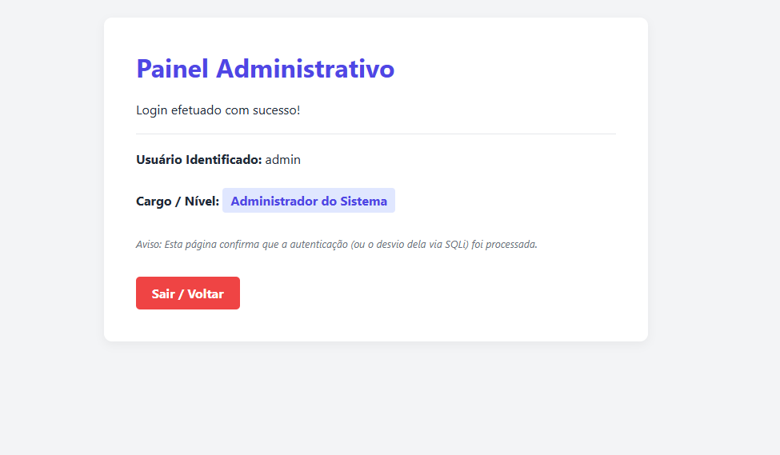
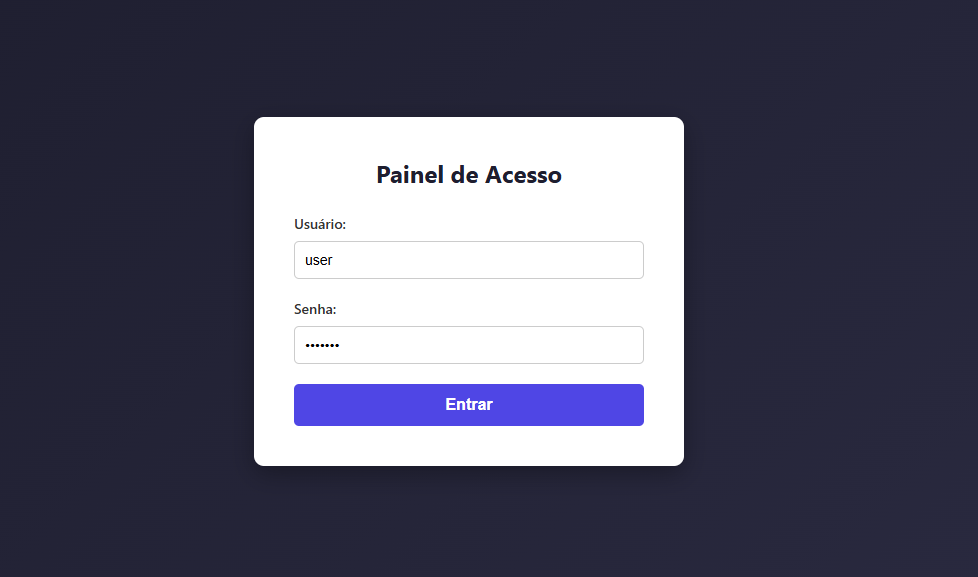
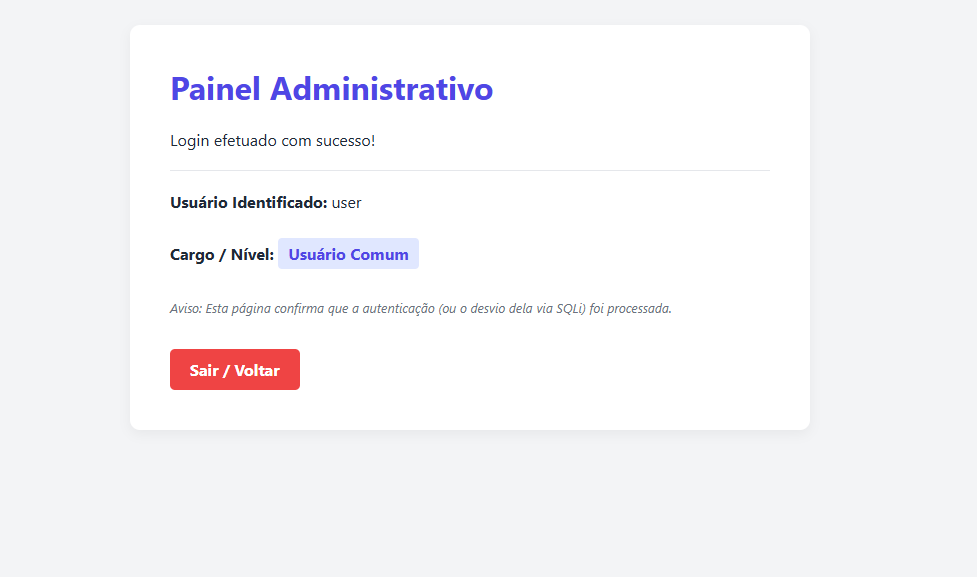
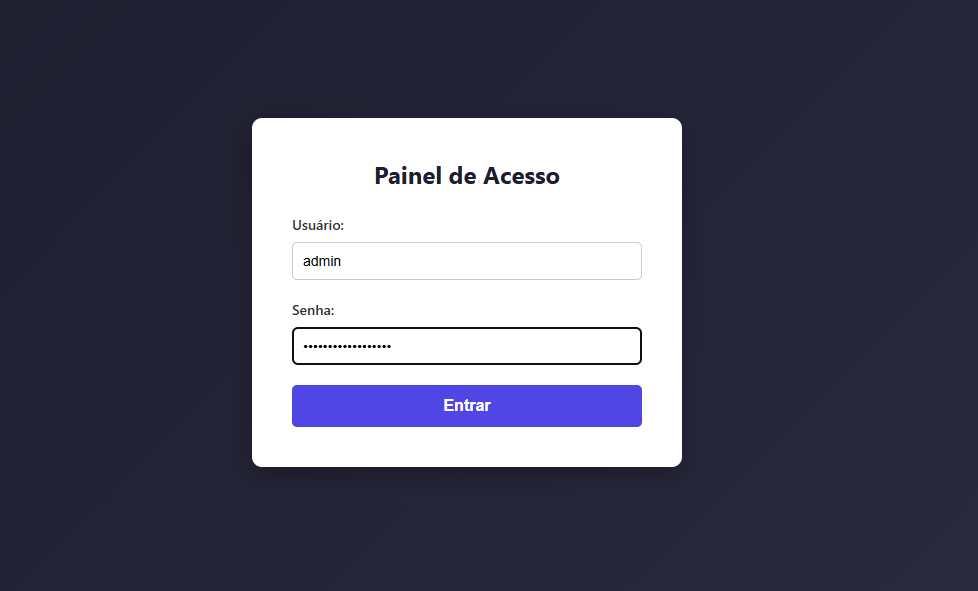
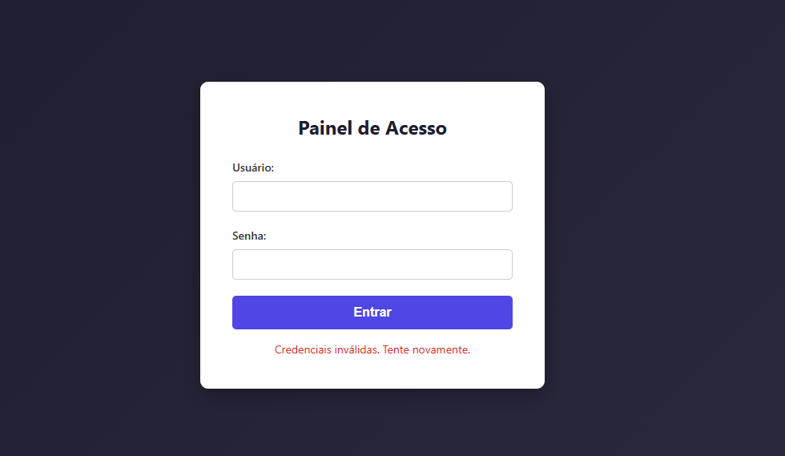

# Laboratório_de_SQL_Injection_Flask _SQLite
# 🔐 Laboratório de SQL Injection (SQLi) — Flask + SQLite

Laboratório desenvolvido em Python com Flask e SQLite para demonstrar, em ambiente local, como uma aplicação web pode ficar vulnerável a **SQL Injection (SQLi)** quando utiliza concatenação direta de dados fornecidos pelo usuário em consultas SQL.

O projeto simula uma página de login com dois usuários de teste e um painel que exibe o nome e o nível de acesso do usuário autenticado.

```bash
from flask import Flask, render_template_string, request
import sqlite3

app = Flask(__name__)


# Inicializa o banco de dados com dados de exemplo
def init_db():
  conn = sqlite3.connect("database.db")
  cursor = conn.cursor()

  # Opcional: Apaga a tabela antiga para garantir que a estrutura nova seja aplicada
  cursor.execute("DROP TABLE IF EXISTS users")

  cursor.execute(
      "CREATE TABLE users (id INTEGER PRIMARY KEY AUTOINCREMENT, username"
      " TEXT, password TEXT, role TEXT)"
  )

  # Inserindo um usuário administrador e um comum
  cursor.execute(
      "INSERT INTO users (id, username, password, role) VALUES (1, 'admin',"
      " 'admin123', 'Administrador do Sistema')"
  )
  cursor.execute(
      "INSERT INTO users (id, username, password, role) VALUES (2, 'user',"
      " 'user123', 'Usuário Comum')"
  )
  conn.commit()
  conn.close()

# Template da Página de Login (Estilizada)
LOGIN_TEMPLATE = """
<!DOCTYPE html>
<html lang="pt-BR">
<head>
    <meta charset="UTF-8">
    <title>Login - Laboratório SQLi</title>
    <style>
        body {
            font-family: 'Segoe UI', Tahoma, Geneva, Verdana, sans-serif;
            background: linear-gradient(135deg, #1e1e2f, #2a2a40);
            height: 100vh;
            display: flex;
            justify-content: center;
            align-items: center;
            margin: 0;
            color: #fff;
        }
        .login-card {
            background: #ffffff;
            color: #333;
            padding: 40px;
            border-radius: 10px;
            box-shadow: 0 8px 24px rgba(0,0,0,0.3);
            width: 350px;
        }
        h2 {
            margin-top: 0;
            color: #1e1e2f;
            text-align: center;
            margin-bottom: 25px;
        }
        .form-group {
            margin-bottom: 20px;
        }
        label {
            display: block;
            margin-bottom: 8px;
            font-weight: 600;
            font-size: 14px;
        }
        input[type="text"], input[type="password"] {
            width: 100%;
            padding: 10px;
            border: 1px solid #ccc;
            border-radius: 5px;
            box-sizing: border-box;
            font-size: 14px;
        }
        input[type="submit"] {
            width: 100%;
            background: #4f46e5;
            color: white;
            border: none;
            padding: 12px;
            border-radius: 5px;
            font-size: 16px;
            font-weight: bold;
            cursor: pointer;
            transition: background 0.2s;
        }
        input[type="submit"]:hover {
            background: #4338ca;
        }
        .error-msg {
            margin-top: 15px;
            color: #dc2626;
            text-align: center;
            font-size: 14px;
        }
    </style>
</head>
<body>
    <div class="login-card">
        <h2>Painel de Acesso</h2>
        <form method="POST">
            <div class="form-group">
                <label>Usuário:</label>
                <input type="text" name="username" required autocomplete="off">
            </div>
            <div class="form-group">
                <label>Senha:</label>
                <input type="password" name="password" required>
            </div>
            <input type="submit" value="Entrar">
        </form>
        
            <div class="error-msg">{{ message }}</div>
        
    </div>
</body>
</html>
"""

# Template da Página de Dashboard (Após o Login)
DASHBOARD_TEMPLATE = """
<!DOCTYPE html>
<html lang="pt-BR">
<head>
    <meta charset="UTF-8">
    <title>Painel - Bem-vindo</title>
    <style>
        body {
            font-family: 'Segoe UI', Tahoma, Geneva, Verdana, sans-serif;
            background: #f3f4f6;
            margin: 0;
            padding: 40px;
            color: #1f2937;
        }
        .dashboard-container {
            max-width: 600px;
            margin: 0 auto;
            background: #ffffff;
            padding: 40px;
            border-radius: 10px;
            box-shadow: 0 4px 12px rgba(0,0,0,0.05);
        }
        h1 { color: #4f46e5; margin-top: 0; }
        .badge {
            background: #e0e7ff;
            color: #4f46e5;
            padding: 5px 10px;
            border-radius: 4px;
            font-weight: bold;
            display: inline-block;
            margin: 10px 0;
        }
        .logout-btn {
            display: inline-block;
            margin-top: 20px;
            background: #ef4444;
            color: white;
            padding: 10px 20px;
            text-decoration: none;
            border-radius: 5px;
            font-weight: bold;
        }
        .logout-btn:hover { background: #dc2626; }
    </style>
</head>
<body>
    <div class="dashboard-container">
        <h1>Painel Administrativo</h1>
        <p>Login efetuado com sucesso!</p>
        <hr style="border: 0; border-top: 1px solid #e5e7eb; margin: 20px 0;">
        <p><strong>Usuário Identificado:</strong> {{ username }}</p>
        <p><strong>Cargo / Nível:</strong> <span class="badge">{{ role }}</span></p>
        <p style="color: #6b7280; font-size: 13px; margin-top: 20px;"><em>Aviso: Esta página confirma que a autenticação (ou o desvio dela via SQLi) foi processada.</em></p>
        <a href="/" class="logout-btn">Sair / Voltar</a>
    </div>
</body>
</html>
"""


@app.route("/", methods=["GET", "POST"])
def login():
  message = ""
  if request.method == "POST":
    username = request.form["username"]
    password = request.form["password"]

    conn = sqlite3.connect("database.db")
    cursor = conn.cursor()

    # VULNERABILIDADE CRÍTICA: Concatenação direta de strings na query SQL
    query = (
        "SELECT * FROM users WHERE username = '"
        + username
        + "' AND password = '"
        + password
        + "'"
    )

    print(f"[DEBUG SQLi] {query}")

    try:
      cursor.execute(query)
      user = cursor.fetchone()
      conn.close()

      if user:
        # Renderiza a nova página de dashboard passando os dados recuperados
        return render_template_string(
            DASHBOARD_TEMPLATE, username=user[1], role=user[3]
        )
      else:
        message = "Credenciais inválidas. Tente novamente."
    except Exception as e:
      conn.close()
      message = f"Erro na consulta SQL: {e}"

  return render_template_string(LOGIN_TEMPLATE, message=message)


if __name__ == "__main__":
  init_db()
  app.run(debug=True, port=5000)
```

> ⚠️ **Aviso de segurança:** esta aplicação contém vulnerabilidades intencionais e utiliza credenciais de demonstração. Execute exclusivamente em um ambiente local, isolado e autorizado. Não a publique em um servidor acessível pela internet.

## 🎯 Objetivos do laboratório

- Compreender o funcionamento de uma vulnerabilidade SQL Injection.
- Identificar os riscos da concatenação de strings em consultas SQL.
- Testar entradas inválidas e payloads de demonstração.
- Entender conceitualmente o bypass de autenticação.
- Observar como erros de SQL podem revelar informações sobre a aplicação.
- Conhecer medidas de prevenção utilizando consultas parametrizadas.

## 🧰 Tecnologias utilizadas

| Tecnologia | Finalidade |
|---|---|
| Python 3 | Linguagem de programação |
| Flask | Framework para aplicação web |
| SQLite | Banco de dados local |
| HTML5 e CSS3 | Interface gráfica de login e painel |
| SQL Injection | Vulnerabilidade estudada |

## 📁 Estrutura do projeto

```text
Laboratorio-SQLi/
├── app.py
├── database.db          # Gerado ao executar o script
├── requirements.txt
└── README.md
```

O arquivo `database.db` é criado automaticamente. A função `init_db()` recria a tabela `users` e insere os usuários de demonstração sempre que o script é iniciado.

**Atenção:** isso apaga os dados anteriores da tabela `users`. Utilize apenas dados descartáveis neste laboratório.

## ⚙️ 1. Pré-requisitos

Instale o Python 3 e verifique se ele está disponível no terminal:

```bash
python --version
```
Instale o Flask (caso não tenha):

```bash
pip install flask
```

Em sistemas que utilizam o comando `python3`:

```bash
python3 --version
```

## 📦 2. Instalação

Crie a pasta do projeto e acesse o diretório:

```bash
mkdir Laboratorio-SQLi
cd Laboratorio-SQLi
```

Salve o código da aplicação no arquivo `lab_pagina.py`.

Crie o arquivo `requirements.txt` com o seguinte conteúdo:

```text
Flask
```

Instale a dependência:

```bash
python -m pip install -r requirements.txt
```

Se estiver usando Linux com Python 3:

```bash
python3 -m pip install -r requirements.txt
```

É recomendável executar o projeto em um ambiente virtual para manter as dependências isoladas.

### Criando um ambiente virtual

**Windows:**

```powershell
python -m venv .venv
.venv\Scripts\activate
python -m pip install -r requirements.txt
```

**Linux / Kali Linux:**

```bash
python3 -m venv .venv
source .venv/bin/activate
python -m pip install -r requirements.txt
```

Se o módulo `venv` não estiver disponível no Kali Linux, instale o pacote correspondente à sua versão do Python por meio dos repositórios oficiais da distribuição.

## ▶️ 3. Como executar o script

No terminal, dentro da pasta do projeto, execute:

```bash
python lab_pagina.py
```

No Linux, se necessário:

```bash
python3 lab_pagina.py
```

A aplicação deverá iniciar na porta `5000`.

Abra o navegador e acesse:

```text
http://127.0.0.1:5000
```

O endereço `127.0.0.1` representa a própria máquina, mantendo o laboratório acessível localmente.

> **Importante:** o código utiliza `debug=True`, adequado somente para desenvolvimento local controlado. Não habilite o modo de depuração em uma implantação de produção.

## 👤 4. Credenciais de demonstração

A aplicação insere dois usuários de teste no banco SQLite.

| Usuário | Senha | Perfil |
|---|---|---|
| `admin` | `admin123` | Administrador do Sistema |
| `user` | `user123` | Usuário Comum |

Digite as credenciais na página de login e clique em **Entrar**.

Se a autenticação funcionar, o sistema exibirá o painel com o usuário identificado e seu perfil.

## 🧪 5. Como testar no laboratório

Faça os testes exclusivamente em `http://127.0.0.1:5000`.

### Teste 1 — Autenticação válida

Utilize as credenciais do administrador:

```text
Usuário: admin
Senha: admin123
```

**Resultado esperado:** acesso ao painel administrativo, com a identificação do usuário `admin`.




Utilize as credenciais do comum:

```text
Usuário: user
Senha: user123
```
**Resultado esperado:** acesso ao painel administrativo, com a identificação do usuário `user`.





### Teste 2 — Credenciais inválidas

Experimente uma combinação que não exista no banco:

```text
Usuário: admin
Senha: senha_incorreta
```

**Resultado esperado:** a aplicação apresenta a mensagem de credenciais inválidas.





Esse teste estabelece o comportamento normal do sistema antes de analisar entradas inesperadas.

### Teste 3 — Entradas com caracteres especiais

No formulário de login, experimente inserir aspas simples (`'`) nos campos de usuário ou senha.

Exemplo:

```text
Usuário: '
Senha: teste
```

Observe o resultado apresentado pela aplicação e o terminal onde o Flask está executando.

O código imprime a consulta SQL construída por meio da mensagem `[DEBUG SQLi]`. Isso permite estudar como os dados recebidos são incorporados à instrução SQL.


**O que analisar:**

- A consulta gerada pelo programa.
- A diferença entre uma entrada comum e uma entrada com caracteres especiais.
- A mensagem apresentada quando ocorre um erro de sintaxe SQL.
- A exposição de detalhes internos da consulta.


## 🧩 6. Análise dos payloads SQL Injection

Um payload é uma entrada criada para verificar como uma aplicação interpreta determinados caracteres ou expressões.

No código deste laboratório, a consulta é construída por concatenação:

```python
query = (
    "SELECT * FROM users WHERE username = '"
    + username
    + "' AND password = '"
    + password
    + "'"
)
```

Essa construção é vulnerável porque os valores fornecidos pelo usuário passam a fazer parte da própria instrução SQL, em vez de serem tratados exclusivamente como dados.

### Categorias de payloads para estudo

| Categoria | O que investigar |
|---|---|
| Aspas simples | Como a aplicação trata delimitadores SQL |
| Entradas com sintaxe inválida | Como são tratados os erros da consulta |
| Condições booleanas | Como expressões lógicas podem alterar o resultado de uma consulta vulnerável |
| Comentários SQL | Como os comentários afetam a interpretação de uma instrução |
| Consultas parametrizadas | Como separar os dados da estrutura SQL |

### Procedimento de análise

1. Inicie a aplicação localmente.
2. Realize um login válido para estabelecer uma referência.
3. Realize um login inválido.
4. Teste uma entrada com aspas simples.
5. Observe a consulta impressa no terminal.
6. Compare os resultados e registre as diferenças.
7. Repita os testes após corrigir a consulta com parâmetros SQL.

Para avaliar payloads booleanos ou comentários SQL, utilize um exercício controlado, com dados descartáveis, e documente o comportamento esperado e observado. Não aplique esses testes a sistemas de terceiros.

## 🔓 7. Bypass de autenticação — análise conceitual

O bypass de autenticação ocorre quando uma aplicação concede acesso sem validar corretamente as credenciais fornecidas.

Neste laboratório, o risco decorre da forma como o código combina os campos `username` e `password` com a consulta SQL. Se uma entrada alterar a lógica da instrução, o resultado da consulta poderá não representar uma autenticação legítima.

### Como estudar o problema

1. Estabeleça o resultado de um login válido.
2. Estabeleça o resultado de um login inválido.
3. Analise a consulta SQL registrada no terminal.
4. Identifique onde os valores fornecidos pelo usuário são concatenados.
5. Investigue, em um ambiente de testes, como a interpretação da consulta pode diferir da intenção original.
6. Corrija a consulta e repita os testes para verificar se entradas manipuladas continuam alterando a autenticação.

**Critério de sucesso:** após a correção, o acesso deve depender de uma correspondência válida entre usuário e senha, e não da possibilidade de modificar a lógica SQL por meio dos campos do formulário.

# 🧪 8. Testando os Payloads no Laboratório

Esta seção demonstra como testar a autenticação e analisar o comportamento de entradas SQL especiais na aplicação Flask com SQLite.

**Ambiente de teste:** `http://127.0.0.1:5000`


### Bypass de autenticação clássico — análise de SQL Injection


Ao testar o payload `' OR '1'='1`, a consulta SQL gerada pela aplicação apresenta a seguinte estrutura:

```sql
SELECT * FROM users
WHERE username = '' OR '1'='1'
AND password = '...'
```

Em SQL, o operador `AND` tem precedência sobre o operador `OR`. Portanto, a condição é interpretada da seguinte forma:

```sql
WHERE username = ''
   OR ('1'='1' AND password = '...')
```

Embora a expressão `'1'='1'` seja sempre verdadeira, a condição completa entre parênteses também exige que a senha corresponda ao valor informado.

Se a senha não corresponder, essa parte da expressão será falsa. Como consequência, se não existir um usuário com nome vazio, a consulta não retornará registros.

**Conclusão:** compreender a precedência dos operadores lógicos é essencial para analisar o comportamento de uma consulta vulnerável a SQL Injection.

# 10. Análise de comentários SQL e condições booleanas

Em aplicações que concatenam diretamente os valores fornecidos pelo usuário, comentários SQL e operadores lógicos podem alterar a interpretação da consulta original.

#### Payload com comentário SQL

Considere a entrada de teste:

- **Campo Usuário:** `admin' --`
- **Campo Senha:** valor de teste

A aplicação vulnerável pode incorporar essa entrada à consulta de autenticação. No SQLite, a sequência `--` inicia um comentário que se estende até o final da linha.

Por exemplo, a estrutura original é:

```sql
SELECT * FROM users
WHERE username = '...'
AND password = '...'
```

Se o comentário for introduzido de forma que alcance a verificação da senha, parte da instrução poderá deixar de ser interpretada como SQL executável.

**O que observar no laboratório:**

- A consulta completa exibida no terminal.
- O posicionamento dos delimitadores de string.
- O início e o término do comentário SQL.
- A diferença entre a autenticação original e a consulta alterada.

O resultado depende da consulta efetivamente gerada e da sintaxe utilizada. A presença de `--`, isoladamente, não garante que o acesso será concedido.

#### Análise de condições com `OR`

Outra categoria de teste consiste em estudar expressões booleanas que utilizam o operador `OR`.

Por exemplo, uma condição como:

```sql
'1'='1'
```

é sempre verdadeira. Entretanto, o efeito dessa condição sobre a autenticação depende de sua posição na consulta, da precedência dos operadores e das demais condições avaliadas.

**Importante:** acrescentar uma condição verdadeira não garante, por si só, que um usuário específico, como `admin`, será selecionado.


## 🛡️ 11. Como corrigir a vulnerabilidade

A medida principal é substituir a concatenação direta por uma consulta parametrizada.

Em vez de construir a consulta incorporando os valores recebidos, utilize:

```python
query = """
    SELECT id, username, password, role
    FROM users
    WHERE username = ? AND password = ?
"""

cursor.execute(query, (username, password))
user = cursor.fetchone()
```

O SQLite trata os valores fornecidos como parâmetros, impedindo que esses valores sejam interpretados como parte da estrutura SQL.

### Outras melhorias recomendadas

- Armazenar senhas com hash seguro, utilizando uma biblioteca apropriada.
- Evitar exibir erros SQL detalhados aos usuários.
- Desativar `debug=True` fora do ambiente de desenvolvimento.
- Aplicar validação de entrada conforme as regras de negócio.
- Implementar gerenciamento de sessão e controle de acesso por perfil.
- Evitar recriar ou apagar tabelas automaticamente em ambientes de produção.
- Adicionar testes automatizados para autenticação válida, inválida e entradas manipuladas.

> **Observação:** parametrizar a consulta é essencial para prevenir SQL Injection, mas não substitui o armazenamento seguro de senhas nem as demais medidas de proteção de autenticação.

## 📋 12. Checklist de testes

- [ ] Aplicação iniciada sem erros.
- [ ] Página de login acessível localmente.
- [ ] Login válido do administrador testado.
- [ ] Login válido do usuário comum testado.
- [ ] Login com senha incorreta testado.
- [ ] Entrada com aspas simples testada.
- [ ] Consulta SQL gerada analisada.
- [ ] Tratamento de erros avaliado.
- [ ] Consulta parametrizada implementada.
- [ ] Testes repetidos após a correção.
- [ ] Modo de depuração desativado para qualquer implantação.

## 📚 13. Conceitos estudados

- SQL Injection (SQLi)
- Autenticação baseada em banco de dados
- Manipulação de consultas SQL
- SQLite e Python
- Flask e formulários HTTP POST
- Validação de credenciais
- Tratamento de erros
- Consultas parametrizadas
- Princípios de desenvolvimento seguro

## ⚖️ Uso responsável

Este projeto tem finalidade exclusivamente educacional e demonstra uma vulnerabilidade intencional em uma aplicação de laboratório.

Execute os testes somente em sistemas próprios ou em ambientes para os quais você tenha autorização explícita. Não utilize estas técnicas para obter acesso não autorizado, coletar credenciais ou comprometer sistemas reais.

## 👨‍💻 Autor

**Wandreson Silva**

**Projeto educacional de Segurança da Informação e Desenvolvimento Seguro**

Tecnologias: Python • Flask • SQLite • SQL Injection

---

⭐ Se este laboratório foi útil para seus estudos de desenvolvimento seguro e cibersegurança, considere deixar uma estrela no repositório.

